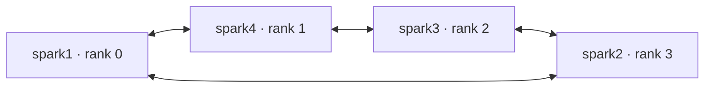

# Direct cables and hardware-forwarded diagonals

Each Spark has two 200 Gb/s physical ring cables and four HCA functions, with
primary/twin functions on each edge. The source profile names port f0 as
clockwise and f1 as counter-clockwise. Model rank order follows that orientation;
physical host numbering does not determine rank order. All four hosts participate.

The tested cable layout gives the following model rank order. Each edge has
primary and twin functions on two PCIe roots, sharing one physical cable:

| Rank | Host | f0 connects to | f1 connects to | Opposite host |
| ---: | --- | --- | --- | --- |
| 0 | spark1 | spark4 f1 | spark2 f0 | spark3 |
| 1 | spark4 | spark3 f1 | spark1 f0 | spark2 |
| 2 | spark3 | spark2 f1 | spark4 f0 | spark1 |
| 3 | spark2 | spark1 f1 | spark3 f0 | spark4 |

Direct peers use both Socket Direct functions on their shared edge. Opposite
peers use the two hardware-forwarded directions with functions on both PCIe
roots. Qualification and each final benchmark window require payload on all
16 functions across the cluster. This establishes path use rather than peak
200 Gb/s utilization.

The selected SparkRing planner uses `adjacent_gateway` routes and two paths to
each opposite peer. Each rank adds two diagonal `/32` routes via a directly
connected neighbor, two intermediate TC rules and two source-marker processes.
It does not use the planner's alternate permanent-final-neighbor strategy.
Existing connected fabric addresses, MTU and management routes are retained.

The source marker changes the Ethernet EtherType for selected RDMA-TX packets
using the reserved UDP source port. An intermediate ConnectX ASIC restores the
EtherType, rewrites the destination MAC and redirects the packet to the next
physical edge. IP, UDP, RDMA headers and payload are preserved. Reverse RC
traffic needs the corresponding reverse hardware path.

TC rules require `skip_sw` and verified `in_hw` placement. Source-marker exit
removes its native rule, so marker identity and health are part of model
readiness and stopping. A software fallback is not a valid qualification.
Routes alone do not establish correct or fast RDMA communication.

The operator authorized the endpoint routes required by the current RoCEnante
profile. This integration adds only the two reviewed diagonal `/32` routes per
rank. It does not install SparkRing's broader appliance reachability, change
forwarding sysctls, add NAT or change firewall policy. Existing settings remain
as found. The diagonal transit path must execute in the ConnectX ASIC: hardware
qualification requires positive packet and byte deltas on all eight exact TC
rules, with `skip_sw`, `in_hw`, zero software traffic and zero drops. Existing
OS forwarding settings alone cannot establish that proof.

RoCEnante's forwarded posting window depends on the ConnectX hairpin queue.
The upstream 128 KiB window assumes 8192 entries. A 1024-entry queue requires
a window of 32 KiB or less. Changing driver-init queue parameters requires an
idle stack and a privileged fabric NIC function reload. Preparation journals
each PCI function's original driver-init value and reload count, sets the
required queue size to 8192 and enables hardware TC offload only if necessary.
It records every change for `rollback --restore-driver`. Management NICs are
outside this operation; firmware and installed drivers are not replaced.

On the tested hosts, reloading a dedicated fabric function made NetworkManager
remove its inactive, automatically generated DHCP profile from `/run`. The
active fabric profile and persistent configuration remained intact. Preparation
archives the private configuration before reload. This disappearance still
fails the strict configuration guard; there is no blanket `/run` exclusion.
Stop and inspect the unqualified observation and root-only archive. Identify
the removed profile's UUID, interface and inactive generated status, retain its
bytes and hashes, and verify active/persistent profiles and other preserved
state before collecting a new reviewed inventory and retrying recovery or
preparation. Unexplained, active or persistent profile changes remain failures.
Firewall comparisons ignore live chain counters and save timestamps, while
preserving rules and policies.
NetworkManager can also reassign automatic metrics on directly connected fabric
routes. Only an exact connected route with an attested successful PCI reload
admits that metric change. Collect a fresh inventory after preparation before
applying the mesh; original before-state backups remain archived.

Rollback captures a fresh four-host snapshot and completes every host's idle
check before any mutation. The retained inventory binds the physical topology
and MAC plan; it is not used as a stale route baseline. Only full route rows
actually deleted from current-boot owned journal entries are projected out of
the fresh snapshot. Every removal binds the recipe, plan, node, rank, boot and
resource identity and must be absent afterward. Remaining routes, management
defaults, profiles, forwarding settings and firewall policy remain strict.
Prior-boot retirement produces no route deletion attestation and cannot hide a
foreign route at the same destination. See [recovery steps](system-changes.md).

The planner and read-only inventory must produce the exact per-host additions,
ownership checks, pre-change snapshot and rollback before application. Existing
unowned routes/rules must never be silently replaced. Qualification checks
bidirectional RC payloads, all sixteen per-function counters, errors, native
health, hardware rule placement and preserved host configuration.

Upstream [hardware-forwarding contract](https://github.com/FujitsuPolycom/sparkring/blob/6d27dd10a9f97da21278ae504ea6235f8634f303/spark_transport/fabric/cx7_hairpin_diagonal/README.md)
and [selected planner](https://github.com/FujitsuPolycom/sparkring/blob/6d27dd10a9f97da21278ae504ea6235f8634f303/spark_transport/fabric/cx7_hairpin_diagonal/fabric.py)
define this path. Hardware forwarding does not add cable bandwidth and does
not provide GPUDirect RDMA to the GB10 GPU; the endpoints use mapped host memory.
